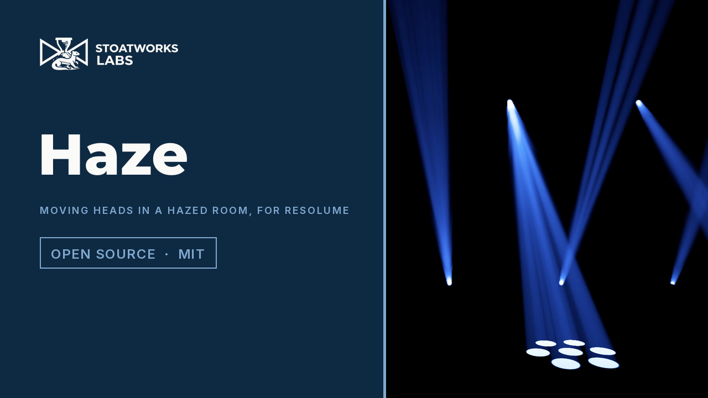

# haze

> **AI-assisted project.** This codebase was created with [Claude](https://claude.com/claude-code)
> (Anthropic), directed and reviewed by a human author. It has **never been loaded into
> Resolume on macOS**. On Windows its release build loads, registers and renders in Resolume
> Arena 7.27.1 on software rendering, with every control as declared. Everything else below is
> measured by an offline harness, `hztest`, that drives the real plugin classes in a headless
> GL context on a synthetic clock, on this Mac's GPU at two rasters and partly on Apple's
> software renderer, and reads linear radiance straight off the plugin's own float output.
> The scattering is checked against the physics, not against screenshots. The phase function
> recovered from the picture is Henyey–Greenstein's to **0.83%** over 64 combinations of
> angle, anisotropy and distance. The haze's dimming is Beer–Lambert, a slope equal to the
> light's path to **5e-8**. Down the beam, the lens is the disc of luminance I₀/πa² it should
> be, to **1.3e-6**. The servo moves take their closed-form times to **7e-15 s**, from the
> Mythos manual's full-range times. The Sweep chase keeps up at 40 BPM and misses every step
> at 41, where the closed form puts the limit at 40.64. The gobo's edge is sharpest at the
> focus distance (1.6 px) and blurs away from it as the lens's defocus disc predicts, to 2%.
> **17** deliberately wrong models and **26** one-character mutants of the shipped GLSL and
> C++ are all caught. The droplet size, the motors' acceleration and how the haze is stirred
> are **assumptions**: see [Status](#status).

Moving heads in a hazed room, for [Resolume](https://resolume.com) Arena and Avenue, as
two FFGL plugins: **SW Haze**, a source that is a rig of moving heads chasing on the beat in
a hazed room, and **SW Haze Over**, an effect in which the same rig plays in front of your
clip on the back wall, or carries it as its gobo.


<sub>One frame of the source, rendered by `hztest`, the offline harness, not captured from
Resolume, on 16 November 2026: eight fixtures, alternately on the truss and the floor, in a
Wave, blue, through the default heavy concert haze (`--set "Layout=Split" --set
"Pattern=Wave" --set "Colour=Blue" --set "Fixtures=0.64" --set "Spread=0.45" --frames
200`).</sub>


<sub>The Over on its defaults on the same harness, Resolume's bundled `IntoTheGlow_02` as
the clip, its 150th frame through `--pipe` (`--over --pipe --size 1280x720`).</sub>

<!-- downloads:start -->

## Download

**[v0.1.0](https://github.com/stoatworks-labs/haze/releases/tag/v0.1.0)** — prebuilt for macOS and Windows. Pick your platform:

<details>
<summary><b>macOS</b> — Universal (Apple Silicon + Intel)</summary>

| Build | Download | Size |
| --- | --- | --- |
| Universal (Apple Silicon + Intel) · .dmg disk image | [`haze-0.1.0-macos-universal.dmg`](https://github.com/stoatworks-labs/haze/releases/download/v0.1.0/haze-0.1.0-macos-universal.dmg) | 477 KB |
| Universal (Apple Silicon + Intel) · .zip archive | [`haze-macos-universal.zip`](https://github.com/stoatworks-labs/haze/releases/latest/download/haze-macos-universal.zip) | 418 KB |

</details>

<details>
<summary><b>Windows</b> — x64</summary>

| Build | Download | Size |
| --- | --- | --- |
| x64 · .exe installer | [`haze-0.1.0-windows-x86_64-setup.exe`](https://github.com/stoatworks-labs/haze/releases/download/v0.1.0/haze-0.1.0-windows-x86_64-setup.exe) | 271 KB |
| x64 · .zip archive | [`haze-windows-x86_64.zip`](https://github.com/stoatworks-labs/haze/releases/latest/download/haze-windows-x86_64.zip) | 262 KB |

</details>

All builds, checksums and release notes: [github.com/stoatworks-labs/haze/releases](https://github.com/stoatworks-labs/haze/releases).

macOS builds are signed and notarised and open normally. The Windows builds are unsigned, so SmartScreen warns once.

<!-- downloads:end -->

## Video

> **Photosensitivity warning:** the video shows moving-head lighting and contains flashing
> lights. The one pattern that flashes, Audience, is shown slowed to one step a bar and 3
> stops down.

[](https://www.youtube.com/watch?v=Tamncu5lPhI)

## The one idea

**A beam is only visible because the haze scatters a little of it at you, and how much
depends on the angle between the beam and your eye.**

Each fixture is a lamp, a gobo and a lens on a pan/tilt yoke: one fixture model, Clay
Paky's Mythos, because its manual gives every number this needs (a 157 mm lens, 24,000
lumens, the zoom range, and how fast it pans and tilts). Its light leaves the lens as a cone
carrying the gobo's picture, sharp at one distance and blurred everywhere else. Every
droplet of haze the beam passes scatters a fraction of it per metre, into directions
weighted by the Henyey–Greenstein phase function, and the haze between the droplet and the
lens, and between the droplet and your eye, dims it by Beer–Lambert's exp(−σL). For every
pixel the plugin integrates, along your line of sight, the light each beam scatters toward
you, adds what the beams light on the back wall and the floor, and the lenses themselves
where you look into one.

So the plugins are the haze, the fixtures and their motors:

- **the haze** is mineral oil droplets, which absorb nothing, at a density you set in m⁻¹.
  Its forward bias (g = 0.70 by default) comes from Mie scattering by oil droplets of a
  typical hazer's size, computed by `tools/mie.py`. It's stirred: the density varies slowly
  through the room and drifts;
- **the fixtures** are the Mythos's optics: its flux spread over the beam, its lens as the
  aperture that blurs the gobo away from the focus distance, and its lens seen as a bright
  disc when the beam points at you;
- **the motors** are speed- and acceleration-limited servos, time-optimal, with pan and tilt
  synchronised so they arrive together (the Mythos's "vectorial" movement). They step on the
  beat, on the kick in Resolume's audio input, or when you press Step.

## What falls out

None of this is drawn. It's the haze and the motors doing what they do.

- **Faint from the side, blazing down the beam.** At the default anisotropy the haze
  scatters 67 times more light straight ahead than at right angles, so a beam seen side-on
  is a faint shaft and the same beam swung toward the camera flares. Its lens, when it
  points straight at you, is the brightest thing in the frame.
- **Chases late at high BPM.** Sweep swings every head 127° of pan a step, whatever the
  Spread (the Spread sets how far the beams lean, not how far the yokes pan). From rest at
  full speed that takes 1.48 s, so the chase keeps up to 40.6 BPM. At 120 BPM the heads turn
  back long before they arrive, and only 4 of 22 steps ever get there. Slow the tempo and
  they land. Motor Speed scales the motors: even at 150% a step takes 0.98 s.
- **The clip sharp on the wall, smeared along the beam.** The lens images the gobo at the
  Focus distance only. Where the beam meets the back wall at that distance, the gobo (or, in
  the Over, the clip) is sharp; along the beam in the air it's a smear that comes into focus
  only around the Focus distance.
- **Beams thinning where the haze does.** A beam crossing a thin patch of haze goes dim
  there, and two beams crossing the same patch dim at the same place by the same amount: the
  thinning belongs to the place, not the beam.
- **Too much haze dims the beams.** The scattered light grows with the haze but is
  attenuated by exp(−σL), so a beam seen across a path L is brightest at σ = 1/L, and the far
  end of a long beam fades into a thick haze.
- **Spots blow out before beams do.** A lit floor or wall is far brighter than a beam seen
  side-on, so the exposure that shows the beams blows the spots to white, as a photograph of
  a show does.

## Controls

| Group | |
| --- | --- |
| **Fixtures** | Fixtures (1–12), Layout (Line, Arc, Floor, Split), Zoom (the beam, 2.5–30.8°), Gobo (Open, Dots, Bars, Star, Ring, Breakup), Colour (White, Red, Amber, Green, Cyan, Blue, Magenta), Focus (where the gobo is sharp, 2–30 m). |
| **Haze** | Haze (the extinction coefficient, 0.001–0.1 m⁻¹), Anisotropy (g, 0–0.95: how strongly the haze scatters forward), Stir (how much the density varies, 0–1). |
| **Chase** | Pattern (Fan, Cross, Sweep, Audience, Wave, Random, Hold), Step On (4 a Beat, 2 a Beat, Beat, 2 Beats, Bar, Onset, Step Only), Spread (5–90°), Motor Speed (5–150% of the Mythos at Fast), Step (one step now), Audio (Resolume's audio input, for Onset). |
| **View** | Orbit (the camera round the stage, −90° to 90°), Exposure (±4 stops), Quality (High, Medium, Low), Clip As (Over: Gobo, Backdrop, Screen), Mix (Over). |

**The defaults** are six fixtures on a truss 7 m up, 12° beams with the Dots gobo focused
at 9 m, through a 0.015 m⁻¹ haze (a heavy concert haze) at g = 0.70, half stirred, fanning
out and in on every beat at full motor speed, seen from front of house at Quality Medium.
The Over's defaults are the same, with the clip on the back wall as a screen.

**Clip As**, in the Over:

- **Screen** (the default): the back wall is a screen showing your clip, dimmed by the haze
  in front of it, with the beams playing in front. With nothing in front, it hands the clip
  straight back.
- **Gobo**: every beam carries your clip as its gobo, cropped square and masked by the
  round gate. Transparent is no light.
- **Backdrop**: the back wall is your clip, printed, revealed only where a beam lands on it.
  "The beams light the clip."

**Audience** aims every other step's beams straight at the camera: at the default exposure
six lenses staring at you white the frame out, as they would.

## Status

**v0.1.0, released 18 November 2026, and early days.** It has **never been loaded into
Resolume on macOS**: `oxbow probe` reads the bundles as a host does (`SW Haze` / `HZ01` /
source, `SW Haze Over` / `HZ02` / effect) and `oxbow selftest` renders through each, and
that is all. **On Windows both plugins have been in Resolume:** the DLLs `release.yml` built
from the registered tree load, register and render in Resolume Arena 7.27.1 on software
rendering (win-lab, Mesa llvmpipe, no GPU, no sound device), with every control as the
plugins declare it (23 host controls on the source, 26 on the effect with Arena's Opacity)
and Arena's log clean, in the fleet's Arena gate: 15 of 15 checks, the audio and Step rows
skipped. With the chase and the stir held still, all 16 of the source's valued controls and
18 of the effect's 19 changed Arena's picture; Motor Speed read inconclusive on the effect
(it acts only while the heads move) and none read dead. Software rendering says nothing
about a GPU or about speed. CI builds both platforms on every push, MSVC with no warnings,
and loads both DLLs as a host does. There's a [user
guide](https://stoatworks-labs.com/software/haze/guide/) and a browser demo, but no presets
and no OpenFX port.

**Photosensitivity.** The defaults don't flash, and nor does any pattern but one.
**Audience** aims every beam at the camera on every other step and whites out the picture,
so it flashes: measured from the plugin's own output with the WCAG general-flash rule, at
120 BPM it's over three flashes a second in part of the picture on Beat and faster (4.5 in
the worst third of the frame), on the line on 2 Beats, and well under on Bar. The guide has
the table and how to keep a show within the guidance.

**Open questions**, known limits for now:

- **SW Haze Over's default Clip As is Screen, not Gobo**, though the clip as the gobo is the
  idea in the name. Screen survived all 21 of Resolume's demo clips; under Gobo a dark clip
  makes dark beams. Gobo is one click away.
- **Audience whites the frame out** at the default exposure: six lenses staring at the
  camera, as they would in a photograph of a show, but maybe not what a VJ picking it from
  a list expects. Three stops down, the lenses read as stars.
- **The stir is hard to see**, especially in stills. A finer field or a different control
  law would show more structure; a Stir above 1 would break the haze's mean.
- **The clip on the back wall fills about half the frame's width** at the default camera.

### Measured offline, on macOS

`tools/verify.sh` passes on this machine (Apple Silicon, macOS 26) against a fresh universal
Release build (16 November 2026, three minutes). It runs every picture check at **two
rasters**, 1280×720 and 320×180, and seven of them again on **Apple's software renderer** at
320×180. What it establishes:

| check | result |
| --- | --- |
| `--phase` | a 2.5° beam crossed by the camera's rays at 20° to 160°, g 0, 0.5, 0.7 and 0.9, 6 and 12 m from the lens: the phase function recovered from the picture is Henyey–Greenstein's to **+0.70%** (720p) and **+0.83%** (180p) at worst, bound 3% |
| `--extinction` | a beam square to the wall: ln L against σ is a line of slope **24.317821 m**, the light's path (lens to wall 10 m, wall to eye 14.317821 m) to **1.3e-8** relative; side-on in the air, 17.948 m against 18 m (**−0.29%**), brightest at σ = 1/L |
| `--lens` | down the beam, the lens's luminance is I₀/(πa²), dimmed by the haze in between, to **1.3e-6**; I₀ is 697,270 cd, the manual's 24,000 lm over the 12° beam's solid angle |
| `--servo` | the shipped limits give the manual's full-range times exactly (pan 540° in **3.517 s**, tilt 244° in **2.180 s**); 48 rest-to-rest moves at 5%, 100% and 150% speed take the closed-form time to **7.1e-15 s** and agree with an independent phase-plane integrator to 1.9e-5 s; synced axes arrive together to 2.9e-15 s; 5 retargets mid-move (reversing, overshooting, too fast to stop short) match the integrator to 1.6e-5 s; 4000 directions round-trip through the inverse kinematics to 9e-16 |
| `--late` | Sweep, through the plugin: at 40 BPM **6 of 6** steps land, each in the closed-form 1.4763 s; at 41 BPM **0 of 6**; at 120 BPM 4 of 22. The pan at 3.217 s is the same at 24, 30, 60 and 240 fps to **9.2e-14°** |
| `--chase`, `--beat` | the chase steps on the host's beat crossings, inside the frame, at 30 and 240 fps, to **4.4e-16 s**, and through the whole plugin to 3.4e-8 s; three presses of Step make three steps, four onsets four, Hold none |
| `--aim` | a beam square to the wall and to the floor, seen from behind its lens: the spot's centroid is the frame's centre to **0.0000 px** |
| `--focus` | a wall 10 m away: the gobo's edge is **1.63 px** wide at Focus 10 m, the sharpest of the sweep, 37.3 px at 4 m and 16.5 px at 30 m, growing with the defocus disc at **0.696** of its width against a uniform disc's 0.687 (bound 5%; 0.675 at 180p). In the air, a grating's contrast along the beam peaks at 6.75, 9.25 and 11.75 m for Focus 7, 9 and 12 m, each within a sample bin |
| `--gobo` | the Over's clip on the wall and the floor reads as the clip does, upright and unmirrored, from behind the lens and from the audience |
| `--density` | the stir's mean over the room is **+0.0025** (bound 0.035, its sampling error), its range −0.85 to +0.95; along a beam the brightness follows 1 + s·n from the field to **0.0005**; two crossing beams dim by the same factor to **0.93%** (bound 2%), while the stir moves each by up to 47% |
| `--alpha` | the Over at Mix 0 returns the clip with **0** of 3,686,400 floats different; its alpha is mix(clip, 1, Mix) to 2.4e-8 in every Clip As; Screen with nothing in front returns the clip through the haze to 1.3e-7; the source's alpha is 1 |
| `--audio` | seven kicks in the FFT buffer, seven steps, each on its kick's own frame; none from a cold start into loud music |
| `--clock`, `--resize`, `--state` | at a 499,000,000 ms host clock the frames stay 1/60 s apart to 6e-11 s and the haze drifts by v·dt; a raster change mid-run is **0 bytes** different from a fresh instance; the host's GL state comes back, both plugins |
| `--names`, `--cues` | 23 and 25 parameters, within FFGL's 16 characters, unique, the About block last; a cue sheet ramps and steps them |
| `--pipe` | both plugins: 2.5 frames in, exactly 2 out; a closed stdout (`\| head -c 1`) exits 1, not 141 |
| `--negative` | **17** deliberately wrong models, **17** caught |
| mutation | **26** one-character mutants of the shipped GLSL and C++, **26** caught |
| `tools/sweep.py` | all **17** controls of the source and **19** of the Over that have pixels measurably change the picture |
| `tools/mie.py --check` | the Mie code behind the default anisotropy against three of Wiscombe's published values |
| shaders | all 5 compile through `glslc`, not merely through Apple's driver |
| the bundles | both universal (`x86_64 arm64`), export `plugMain`, ad-hoc sign; `oxbow` reads their name, id and type and renders through both |

Render cost, GPU time by `GL_TIME_ELAPSED`, median of 120 frames after 240 of warm-up
(4K: 30 after 30), from verify.sh's run on 16 November 2026 on an M4 Max shared with other
builds. At the defaults (Quality Medium) the source takes **0.23 ms** at 720p, **0.34 ms**
at 1080p and **0.96 ms** at 4K; the Over **0.25**, **0.45** and **1.26 ms**. At 1080p,
Quality High takes the source to 0.62 ms and Low to 0.26; twelve 30.8° beams at Medium,
0.73 ms. An earlier run the same hour gave up to 12% less. Quality sets the air's raster (full, half or a quarter) and samples per beam (32,
24, 16); surfaces and lenses are always drawn at the full raster, so the gobo on the wall
stays sharp at any Quality. macOS figures only, on one GPU.

**Resolume's demo clips.** All 21 of the bundled clips this Mac has (Shop74's 15 and six of
the AV set) went through the Over's defaults for 150 frames at 640×360 by `--pipe`, and were
judged by eye on a contact sheet: in all 21 the beams read and the clip is on the screen
behind them, as dark as it is (three of the clips are nearly black). The screen fills about
the middle half of the frame's width. Gobo was the default until it went through the same sheet:
dark clips made dark beams and the clip itself was lost in them.

### Not established

- **Resolume on macOS, and on a GPU.** Never loaded on macOS. On Windows it has run only on
  software rendering with no sound device, so nothing is known about Arena's audio reaching
  it, how it looks on a real GPU, or how it performs in a composition.
- **Music.** The harness feeds Onset a synthetic kick; no real music has stepped it.
- **The droplet size is an assumption.** No published size distribution of a hazer's
  output was found. The default g = 0.70 is the Mie asymmetry of light mineral oil droplets
  0.3–1.0 µm across (it moves only between 0.698 and 0.720 over that range), and the Haze
  range comes from Teschke et al.'s measured concentrations on real sets. Henyey–Greenstein
  stands in for Mie's phase function: within a factor 0.73–1.44 of it from 10° to 90° over
  the five droplet distributions `tools/mie.py` tabulates, and short of the backward glory
  by a factor 0.38–0.68 at 150°.
- **The motors' acceleration is an assumption.** The manual gives full-range times, not
  accelerations; each ramp is taken as a quarter of a full-range move.
- **The stir is an assumption.** Nothing published measures how a hazed room's density
  varies; the cell sizes, the drift and the time constant are chosen. The light's dimming
  uses the room's mean density, not the stirred field along each path (about 2% of the
  optical depth at the defaults). In stills the stir is subtle.
- **Single scattering only:** no glow around a beam in thick haze. No gobo rotation, prisms,
  frost, iris or strobe; the filter colours are chosen, not measured dichroics, and White is
  sRGB white, not the lamp's 7,800 K.
- **One fixture.** Below 4.5° a real Mythos switches to its beam mode and stops imaging the
  gobo; here the gobo is always imaged.

## Browser demo

[haze-demo.stoatworks-labs.com](https://haze-demo.stoatworks-labs.com/) runs both plugins'
own GLSL in WebGL2, unedited, fed by a JavaScript port of their CPU half (the servo planner
and its sync, the chase, the stage, the stir's drift and the beat) that only a reader
checks; SW Haze Over plays the rig in front of a generated clip or one you pick. No audio
reaches it, so Step On's Onset never fires. It opens on the plugin's defaults, with a
photosensitivity note at the top for the one pattern that flashes, Audience. It is a demo,
not the plugin, and the page lists what it leaves out.

## Build

macOS (universal: Apple Silicon and Intel), from a checkout with its submodule
(`git clone --recursive https://github.com/stoatworks-labs/haze`, or
`git submodule update --init --recursive` in an existing clone):

```bash
cmake -B build -DCMAKE_BUILD_TYPE=Release
```

```bash
cmake --build build
```

```bash
cmake --install build
```

The last one copies `Haze.bundle` and `Haze Over.bundle` into
`~/Documents/Resolume Arena/Extra Effects`. Restart Arena and they're under Sources as
**SW Haze** and under Effects as **SW Haze Over**.

Windows needs Visual Studio 2022 and vcpkg (for GLEW); see `.github/workflows/ci.yml`,
which builds it there on every push.

## Building and testing

```bash
tools/verify.sh
```

That's the whole lot: shader hygiene and `glslc`, the Mie code's check, a fresh universal
build with no warnings, both bundles' architecture, plist and ad-hoc signature, a host's
view of them through `oxbow`, every check at two rasters and seven on the software
renderer, the pipe, the negative controls, the mutants, the sweep for dead controls and the
render cost. `CLAUDE.md` lists the checks one by one.

Render a frame of your own:

```bash
./build/hztest --out /tmp/haze.png --set "Pattern=Sweep" --set "Colour=Amber"
```

## License

MIT. See [LICENSE](LICENSE) and [ATTRIBUTIONS.md](ATTRIBUTIONS.md).

<!-- attributions:start -->
This project is built on other people's work — see [ATTRIBUTIONS.md](ATTRIBUTIONS.md).
<!-- attributions:end -->
