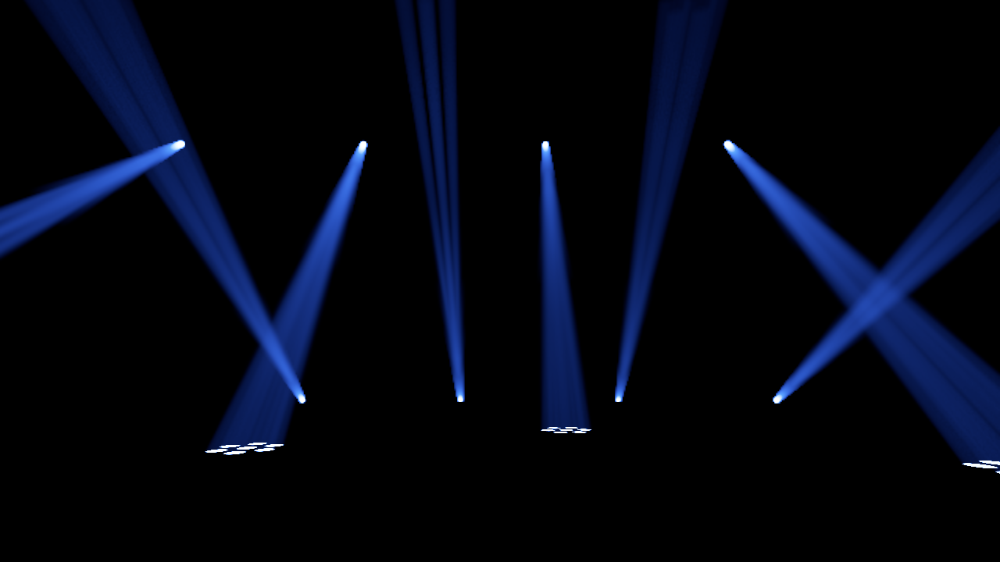

# Haze user guide

> **Photosensitivity note.** One of Haze's chase patterns, **Audience**, flashes. On every
> other step it turns every beam straight at the camera, and six lenses staring at you white
> out the whole picture, then swing away again. Flashing light can trigger seizures in people
> with photosensitive epilepsy, and the guidance for broadcast and the web (Ofcom's, and
> WCAG's) draws the line at **three flashes a second** over a large part of the picture. At
> 120 BPM, Audience on Beat or faster is over that line. The defaults, and every other
> pattern, don't flash. See [Flashing, and keeping it safe](#flashing-and-keeping-it-safe)
> before you put Audience in front of an audience.

Haze is **moving heads in a hazed room, for [Resolume](https://resolume.com) Arena and
Avenue**, as two FFGL plugins in one download: **SW Haze**, a source that is a rig of moving
heads chasing on the beat in a hazed room, and **SW Haze Over**, an effect in which the same
rig plays in front of your clip on a screen at the back of the stage, lights your clip only
where the beams land on it, or carries it as every beam's gobo.

Nothing in it is drawn. A beam is only visible because the haze scatters a little of its
light toward you, and how much depends on the angle between the beam and your eye. For every
pixel, Haze adds up the light each beam scatters toward you along your line of sight, dimmed
by the haze on the way in and on the way out, then adds what the beams light on the back wall
and the floor, and the lenses themselves where one points at you. The fixtures are one real
model, Clay Paky's Mythos, with its manual's lens, brightness, zoom and motor speeds, and the
motors are servos that take time to get anywhere. So a beam seen side-on is a faint shaft and
the same beam swung toward you flares, the gobo is sharp on the wall and a smear in the air,
and a fast chase arrives late.



*One frame of SW Haze from the offline harness, not captured from Resolume: eight fixtures,
alternately on the truss and the floor, in a Wave, blue, through the default heavy concert
haze.*

> **Before you rely on this:** it's at **v0.1.0**, the first release, and early days.
> Everything below was compiled, rendered and measured offline on an Apple Silicon Mac (macOS
> 26), by a harness that drives the plugins' own classes in a headless GL context, at two
> rasters (1280×720 and 320×180) and partly on Apple's software renderer. It checks the
> physics, not screenshots. The phase function recovered from the picture is
> Henyey–Greenstein's to 0.83% over 64 combinations of angle, forward bias and distance; the
> haze's dimming is Beer–Lambert's exp(−σL), a slope equal to the light's path to 5 × 10⁻⁸;
> down the beam the lens is as bright as 24,000 lumens through a 157 mm lens should be, to
> 1.3 × 10⁻⁶; the motors take their closed-form times, from the Mythos manual's full-range
> times, to 7 × 10⁻¹⁵ s; and the gobo is sharpest at the Focus distance and blurs away from
> it as the lens's defocus says, to 2%. Seventeen models that are wrong on purpose and
> twenty-six one-character changes to the shipped code are all caught, and every control
> that has pixels changes the picture.
> It has **never been loaded into Resolume on macOS**. On Windows both plugins have been in
> Resolume: the release's own Windows build loads, registers and renders in Resolume Arena
> 7.27.1 on software rendering (no GPU, no sound device), with every control as declared and
> Arena's log clean, and with the chase and the haze held still every control the automated
> check could move changed Arena's picture (Motor Speed, which acts only while the heads move,
> read inconclusive on the effect). It hasn't yet been seen on a real GPU, with Resolume's
> audio, or through a whole show.
> The droplet size, the motors' acceleration and how the haze is stirred are assumptions
> (see [Known limits](#known-limits)). Try it on a spare layer before you put it in a show.
>
> This codebase was created with AI assistance, directed and reviewed by a human author.

---

## Installing

Every download carries both plugins: **SW Haze**, a source (`Haze.bundle` on macOS,
`Haze.dll` on Windows), and **SW Haze Over**, an effect (`Haze Over.bundle`,
`Haze Over.dll`). Drop them into Resolume's effects folder and restart Resolume:

```
macOS    ~/Documents/Resolume Arena/Extra Effects/
Windows  %USERPROFILE%\Documents\Resolume Arena\Extra Effects\
```

Avenue uses the same layout under its own folder name. SW Haze appears among the sources and
SW Haze Over in the effects browser.

The macOS download is a universal build (Apple silicon and Intel), as a `.dmg` or a `.zip`.
It's **Developer ID-signed and notarised**, so the bundles just load. The Windows download is
an x64 installer or a `.zip`. The installer offers Arena's folder above, or Avenue's on a
machine that only has Avenue; change it on the folder page if you use the other one. It isn't
code-signed, so it trips SmartScreen once: **More info** → **Run anyway**. Or skip the
installer and copy the two `.dll` files out of the `.zip` into the folder by hand.

---

## Start here

1. Put **SW Haze** in a clip slot and play it. The defaults are six moving heads on a truss
   7 m up, fanning out and in on every beat of Resolume's tempo, through a heavy concert haze.
2. If the heads don't move, check **Step On**: on Beat it follows Resolume's tempo, and when
   the transport isn't running it keeps its own clock at the last tempo Resolume sent (120 BPM
   if it never sent one). Press **Step** to move them by hand.
3. Try **Pattern** and watch the heads arrive late as the steps get faster. That's the motors:
   they have a top speed and an acceleration, and a step that comes before they arrive sends
   them somewhere else.
4. Turn **Orbit** to walk round the stage. At ±90° you see the beams side-on, as faint
   shafts; at 0°, front of house, the ones aimed toward you flare.
5. For your own footage, put **SW Haze Over** on a clip. Your clip is on a screen at the back
   of the stage with the rig in front of it. **Clip As** puts it on the beams instead.

The defaults: 6 fixtures, Layout Line, Zoom 12°, Gobo Dots, Colour White, Focus 9 m, Haze
0.015 m⁻¹, Anisotropy 0.70, Stir 50%, Pattern Fan, Step On Beat, Spread 30°, Motor Speed 100%,
Orbit 0°, Exposure 0, Quality Medium. SW Haze Over adds Clip As Screen and Mix 100%.

---

## Recipes

**A sweep that can't keep up.** Pattern **Sweep**, Step On **Beat**. Every head swings 127°
of pan a step, which takes 1.48 s from rest at full speed, so at 120 BPM they turn back long
before they arrive. Slow the tempo to 40 BPM and every step lands.

**Beams that scissor.** Pattern **Cross**, Step On **Bar** or **2 Beats**, Layout **Arc**:
the beams cross through the middle of the stage and back.

**A ripple across the rig.** Pattern **Wave**, Fixtures 8 to 12, Spread 45° to 60°. Each
head leans out in turn, a ripple running across.

**Truss and floor.** Layout **Split** puts every other fixture on the deck, pointing up, so
the beams cross from above and below.

**Fat beams, thick haze.** Zoom up toward 30°, Haze up toward 0.03 m⁻¹, Gobo **Open**: wide
soft cones that fill the room. Past about 0.05 m⁻¹ the haze is a fog, and the far end of each
beam fades into it.

**Pencil beams.** Zoom down to 2.5° to 4°, Gobo **Open**, Haze 0.01 to 0.02 m⁻¹: narrow
shafts, brightest where they come toward you.

**Your clip as the gobo.** In SW Haze Over, Clip As **Gobo**, Exposure up a stop or two: every
beam carries your clip, sharp where it lands on the wall at the Focus distance. It works best
on bright, high-contrast clips; a dark clip makes dark beams.

**The beams light the clip.** In SW Haze Over, Clip As **Backdrop**, Pattern **Wave** or
**Random**, Spread 45° or more so the beams land on the back wall: the clip appears only where
a beam lights it.

**From a pad.** Step On **Step Only**, then map **Step** to a MIDI pad or a key in Resolume:
every press is one step of the pattern. Step also drops an extra step into any other Step On.

**On the music.** Step On **Onset**, then pick a sound source for **Audio** in Resolume: the
chase steps on the kicks.

---

## Flashing, and keeping it safe

Haze's defaults don't flash: the beams are moving light, and the measured brightness of the
picture never jumps by the amounts the guidance counts. That holds for Fan, Cross, Sweep,
Wave, Random and Hold at every Step On up to 4 a Beat at 120 BPM, measured over the whole
picture and over every third-of-the-picture patch, in both plugins.

**Audience is different.** On every other step it aims every beam straight at the camera,
and a lens pointed at you is the brightest thing in the room: at the default exposure six of
them white out the picture, then the heads swing away and it goes dark. People with
photosensitive epilepsy can have a seizure from flashing light, and the line that broadcast
guidance (Ofcom) and web guidance (WCAG 2.x) draw is **no more than three flashes in any
second** over a large area of the picture. A flash here is a rise and a fall in brightness of
at least a tenth of white.

Measured from Haze's own output at 120 BPM, as rises and falls in brightness in the worst second:

| Audience, Step On | steps a second | the whole picture | the worst third of the picture |
| --- | --- | --- | --- |
| Bar | 0.5 | 1 | 3 |
| 2 Beats | 1 | 2 | 6, **at the line**; over it with Orbit turned away from 0° |
| Beat | 2 | 3 | 9, **over** |
| 2 a Beat | 4 | 3 | 9, **over** |
| 4 a Beat | 8 | 7, **over** | 9, **over** |

Two rises and falls make a flash, so the line is six. Most of it is in part of the picture, where the lenses are: the whole picture
stays under the line until 4 a Beat. At other tempos it scales with the steps a second: Beat
at 60 BPM measures as 2 Beats does at 120. SW Haze Over measures the same as SW Haze.

What keeps it within the guidance:

- **Slow steps.** Audience on **Bar** stays within the line at up to 180 BPM. On 2 Beats it
  sits on the line from front of house and goes over it with Orbit turned, so keep 2 Beats
  for slow tempos.
- **Exposure down.** Three stops down (−3), the lenses no longer white out the picture and
  Audience on Beat comes down to the line at 120 BPM. One or two stops down isn't enough.
- **Any other pattern.** Only Audience aims at the camera.

None of this is a substitute for warning your audience. The [browser
demo](https://haze-demo.stoatworks-labs.com/) opens on the defaults, which don't flash, and
pauses any link that opens on Audience.

---

## The Fixtures group

The rig: how many heads, where they hang, and what each one projects.

- **Fixtures** (1 to 12, default 6). Spaced up to 3 m apart across at most 16 m of stage.
- **Layout** (default Line).
  - **Line**: a straight truss 7 m up and 4 m from the back wall, the heads hanging and
    pointing down at rest.
  - **Arc**: the same truss bowed 2 m toward the audience in the middle.
  - **Floor**: on the deck at the back, 0.4 m up, pointing up at rest.
  - **Split**: alternately truss and floor.
- **Zoom** (2.5° to 30.8°, default 12°; the slider's middle is 16.7°). The beam's full angle,
  the Mythos's range. Its 24,000 lumens are spread over the beam, so a narrow beam is
  brighter per degree than a wide one.
- **Gobo** (Open, Dots, Bars, Star, Ring, Breakup; default Dots). The pattern each beam
  projects. In SW Haze Over it acts in Clip As Backdrop and Screen; in Gobo, your clip is the
  gobo.
- **Colour** (White, Red, Amber, Green, Cyan, Blue, Magenta; default White). The colour
  filter. The colours are chosen, not measured from real dichroic filters.
- **Focus** (2 to 30 m, default 9 m; the slider's middle is 7.7 m). Where the lens images the
  gobo sharply. Where a beam meets the wall or the floor at that distance, the gobo is sharp;
  nearer or further it blurs, as much as the lens's 157 mm aperture says it should. Along the
  beam in the air the gobo is a smear that comes into focus only around the Focus distance.

---

## The Haze group

The air the beams pass through. The haze is mineral-oil droplets, which absorb nothing: what
they take out of a beam is scattered.

- **Haze** (0.001 to 0.1 m⁻¹, default 0.015; the slider's middle is 0.01). How much of the
  light the haze scatters per metre, which is also how fast it dims light passing through. The
  default is a heavy concert haze. More haze makes brighter beams, up to a point: the scattered
  light grows with the haze, but so does the dimming, and a beam seen across a path L is
  brightest at about 1/L. The top of the range is a fog.
- **Anisotropy** (0 to 0.95, default 0.70). How strongly the haze scatters forward, along the
  beam, rather than to the side. At 0 a beam looks the same from any angle. At the default,
  worked out from how oil droplets of a typical hazer's size scatter, the haze sends 67 times
  more light straight ahead than at right angles, so a beam seen side-on is faint and the same
  beam pointed toward you blazes. Higher is more dramatic.
- **Stir** (0 to 100%, default 50%). How much the haze's density varies through the room. The
  thick and thin patches drift slowly across the stage and change over about twelve seconds.
  A beam passing through a thin patch dims there, and two beams crossing the same patch dim by
  the same amount. It's subtle, especially in a still frame.

---

## The Chase group

How the heads move. Each step of a pattern sends every head to a new pan and tilt, and the
motors get it there as fast as they can.

- **Pattern** (default Fan).
  - **Fan**: the beams fan out across the rig, then close together, alternately.
  - **Cross**: the beams scissor through the middle of the stage and back.
  - **Sweep**: every beam together, swung to one side, then the other.
  - **Audience**: alternately leaning out, and **every beam aimed straight at the camera**.
    It flashes: see [Flashing, and keeping it safe](#flashing-and-keeping-it-safe).
  - **Wave**: a ripple running across the rig.
  - **Random**: each head somewhere new every step, within the Spread.
  - **Hold**: a fixed spread-out look that never steps.
- **Step On** (4 a Beat, 2 a Beat, Beat, 2 Beats, Bar, Onset, Step Only; default Beat).
  When the chase steps. The tempo choices follow Resolume's beat and land on the exact moment
  the beat falls, even between frames. When Resolume's transport isn't moving, Haze keeps its
  own clock at the last tempo Resolume sent, or 120 BPM. **Onset** steps on a kick in
  **Audio**. **Step Only** steps only when you press Step.
- **Spread** (5° to 90°, default 30°; the slider's middle is 47.5°). How far the beams lean
  away from where they point at rest. It sets the tilt; the pan each pattern swings through is
  the pattern's own, so a narrower Spread doesn't make a chase arrive sooner.
- **Motor Speed** (5% to 150% of the Mythos at its fastest, default 100%; the slider's middle
  is 27%). Scales the motors' top speed and acceleration. Below the default, the heads drift;
  150% is about a Sharpy's pan.
- **Step**. One step now, whatever Step On says. Map it to a pad.
- **Audio**. Resolume's audio input, for Step On Onset. Pick a sound source in Resolume.

**Why the heads arrive late.** The motors are servos with a top speed and an acceleration,
from the Mythos manual's full-range times (540° of pan in 3.5 s, 244° of tilt in 2.2 s). Pan
and tilt are timed to arrive together, as the Mythos's own movement is. A step that comes
before the heads arrive turns them toward the next target from wherever they are, moving. So
at a fast tempo the chase never gets where it's going, and that's the look: Sweep keeps up to
about 40 BPM at full speed, about 60 at 150%.

---

## The View group

- **Orbit** (−90° to 90°, default 0°). The camera walks round the stage on a circle 13 m
  across from the rig's middle, at eye height. 0° is front of house; at ±90° you see the beams
  side-on.
- **Exposure** (−4 to +4 stops, default 0). The camera's exposure. A lit spot on the floor or
  wall is far brighter than a beam seen side-on, so the exposure that shows the beams blows the
  spots to white, as a photograph of a show does. Turn it down to see into the spots, up to
  see faint beams.
- **Quality** (High, Medium, Low; default Medium). How finely the air is computed: High at the
  full resolution with 32 samples a beam, Medium at half resolution with 24, Low at a quarter
  with 16. The wall, the floor and the lenses are always at full resolution, so the gobo stays
  sharp at any Quality. Low shows blocky edges on the beams.

---

## SW Haze Over: your clip in the room

The Over is the same room and rig, with your clip in it. Two more controls, in the View group:

- **Clip As** (Gobo, Backdrop, Screen; default Screen).
  - **Screen**: the back wall is a screen showing your clip, 9 m tall at its own aspect,
    centred, dimmed by the haze in front of it, with the beams playing in front. With nothing
    in front, it hands your clip straight back.
  - **Gobo**: every beam carries your clip as its gobo, cropped to a square and masked by the
    round gate. Where your clip is transparent there's no light.
  - **Backdrop**: the back wall is your clip, printed, seen only where a beam lands on it. The
    beams light the clip.
- **Mix** (0 to 100%, default 100%). At 0 your clip comes back exactly as it went in. In
  between, the room fades in over it. Where the room shows, it's opaque.

Screen is the default because it works on any clip. Gobo is the idea in the name, but the clip
*is* the beams' light there, so a dark clip makes dark beams and the clip itself is never seen
as a picture; it's one click away.

---

## How it works

For every pixel, Haze follows your line of sight through the room and, for each beam, adds up
the light the haze scatters toward you along it. How much is scattered toward you depends on
the angle between the beam and your eye, by the Henyey–Greenstein phase function with the
Anisotropy as its forward bias; on how far the light travelled through the haze to get there,
and on to you, by Beer–Lambert's exp(−σL); and on the gobo's picture at that point in the
beam, blurred by the lens's defocus. The samples along each beam are placed where that beam
comes closest to your line of sight (equiangular sampling), so a narrow beam is never missed.

Then the surfaces: the back wall and the floor, lit by every beam that reaches them, with the
gobo sharp where they meet the Focus distance. And the lenses: where a beam points at you,
its lens is a disc as bright as its flux through a 157 mm aperture says, dimmed by the haze in
between.

The motors are time-optimal servos: each move accelerates as hard as it can, cruises at top
speed if it gets there, and brakes to stop on target, with the slower axis's move stretched so
pan and tilt arrive together. A retarget mid-move starts from the current speed. The beat is
found inside the frame, so the step happens at the beat's own moment, at any frame rate.

---

## Performance

Measured by the offline harness on a Mac (Apple silicon, M4 Max), GPU time per frame, median of
120 frames after a warm-up:

| | 720p | 1080p | 4K |
| --- | --- | --- | --- |
| SW Haze, the defaults (Quality Medium) | 0.23 ms | 0.34 ms | 0.95 ms |
| SW Haze, Quality High | 0.35 ms | 0.59 ms | |
| SW Haze, Quality Low | 0.18 ms | 0.25 ms | |
| SW Haze, 12 fixtures at 30.8° | 0.44 ms | 0.67 ms | |
| SW Haze Over, the defaults | 0.23 ms | 0.41 ms | 1.21 ms |

Nothing was timed inside Resolume, and nothing was timed on Windows.

---

## If it looks wrong

**The heads don't move.** Step On is on Onset with no audio arriving, or on Step Only; or
Pattern is Hold. Press Step to check the rest.

**The heads never get where they're going.** That's the motors: the steps are faster than the
heads can move. Slow Step On, slow the tempo, or raise Motor Speed.

**The picture is white.** Pattern is Audience, and the lenses are aimed at you; or Exposure is
up. Turn Exposure down.

**The beams are hard to see.** From the side, a beam is faint: that's the haze's forward bias.
Raise Haze, raise Anisotropy, raise Exposure, or Orbit round so the beams point more toward
you.

**The spots on the floor are blown white.** They're much brighter than the beams. Turn Exposure
down to see the gobo in them.

**The gobo's blurred on the wall.** It's sharp only at the Focus distance: set Focus to the
distance from the rig to the wall (about 4 m from the truss, more from the floor).

**My clip isn't on the beams.** In SW Haze Over, Clip As is Screen by default: the clip is on
the back wall. Set Clip As to Gobo.

**The plugin draws nothing.** That's what a shader that won't compile looks like. The log has
the error:

```
macOS    ~/Library/Logs/haze/haze.YYYY-MM-DD.log
Windows  %LOCALAPPDATA%\haze\logs\haze.YYYY-MM-DD.log
```

---

## Known limits

- **Never been seen with real music**, or in a whole show. The harness feeds Onset a synthetic
  kick.
- **Audience whites the frame out** at the default exposure: six lenses staring at the camera,
  as they would. Turn Exposure down if that's not what you want. It also flashes (see above).
- **The stir is hard to see**, especially in a still. How a hazed room's density varies isn't
  published anywhere, so the size of the patches, the drift and how fast they change are
  chosen, and the dimming of light uses the room's average density, not the stirred density
  along each path.
- **The screen fills about half the picture's width** in SW Haze Over at the default camera.
- **SW Haze Over's default Clip As is Screen**, not Gobo: see above.
- **The droplet size is an assumption.** No published size distribution of a hazer's output
  was found; the default Anisotropy is worked out for oil droplets 0.3 to 1.0 µm across.
  Henyey–Greenstein stands in for the droplets' real scattering, within a factor of about 0.7
  to 1.4 of it from 10° to 90°.
- **The motors' acceleration is an assumption.** The manual gives full-range times, not
  accelerations.
- **Single scattering only:** no glow round a beam in thick haze. No gobo rotation, prisms,
  frost, iris or strobe; one fixture model; White is sRGB white, not the lamp's colour.
- **The inspector shows slider positions**, not metres or degrees. This guide gives the ranges
  and where the middle of each slider is.
- **No presets** and no OpenFX version.
- **The [browser demo](https://haze-demo.stoatworks-labs.com/) is a port.** It runs the
  plugins' shaders unedited and a JavaScript port of their motors, chase and stir, which only a
  reader checks. It has no audio, so Onset never fires there, and it takes its tempo from the
  page.

---

## About

The last group, **About**, has the plugin's name, version, licence and maker, and buttons that
open the project page, this user guide, the source on GitHub and the support page in your
browser.

## Links

- Project page: [stoatworks-labs.com/software/haze](https://stoatworks-labs.com/software/haze/)
- Source: [github.com/stoatworks-labs/haze](https://github.com/stoatworks-labs/haze)
- User guide: [stoatworks-labs.com/software/haze/guide](https://stoatworks-labs.com/software/haze/guide/)
- Browser demo: [haze-demo.stoatworks-labs.com](https://haze-demo.stoatworks-labs.com/)

## Reporting something

If something's wrong, shout at
[github.com/stoatworks-labs/haze/issues](https://github.com/stoatworks-labs/haze/issues). A
screenshot, which plugin, the Pattern, Step On and Clip As, and the log are usually enough.
